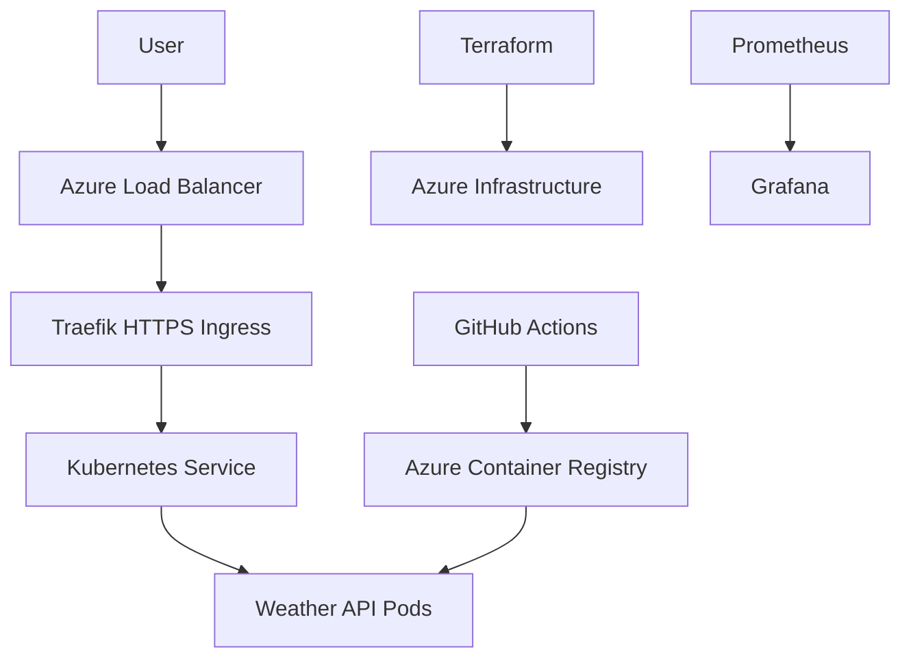

# Enterprise-Grade Kubernetes Deployment on Azure

A cloud-native Weather API deployed on Microsoft Azure
using Docker, Terraform, Kubernetes, and GitHub Actions.

## Technologies Used

- Python and FastAPI
- Docker
- Azure Kubernetes Service (AKS)
- Azure Container Registry (ACR)
- Terraform
- Kubernetes HPA and Cluster Autoscaler
- Traefik Ingress
- cert-manager and Let's Encrypt
- Prometheus and Grafana
- GitHub Actions CI/CD

## Architecture



## Features

- Containerized REST API
- Infrastructure as Code with Terraform
- Kubernetes workload orchestration
- HTTPS using Let's Encrypt
- Horizontal Pod Autoscaling
- Cluster Autoscaler
- Prometheus metrics collection
- Grafana monitoring dashboard
- GitHub Actions CI/CD

## API Endpoints

- GET /
- GET /health
- GET /weather?city=Jaipur
- GET /docs

## Running Locally

```bash
docker build -t weather-api:v1 .
docker run -p 8001:8000 weather-api:v1
```

Open http://localhost:8001/docs

## Monitoring

Prometheus collects Kubernetes metrics, and Grafana
visualizes application replicas, scaling, and node health.

Dashboard configuration:
monitoring/weather-api-dashboard.json

## CI/CD

GitHub Actions automatically runs Python tests on
pushes to main.

Deployments are manually triggered to limit Azure costs.

## Screenshots

See the screenshots/ directory for deployment evidence.

## Demo Availability

The API has been deployed with HTTPS on Azure AKS.

The cluster may be stopped outside demonstration
sessions to minimize Azure costs.

## Project Purpose

Demonstrate cloud infrastructure provisioning,
container orchestration, security, autoscaling,
monitoring, and automated application delivery.
